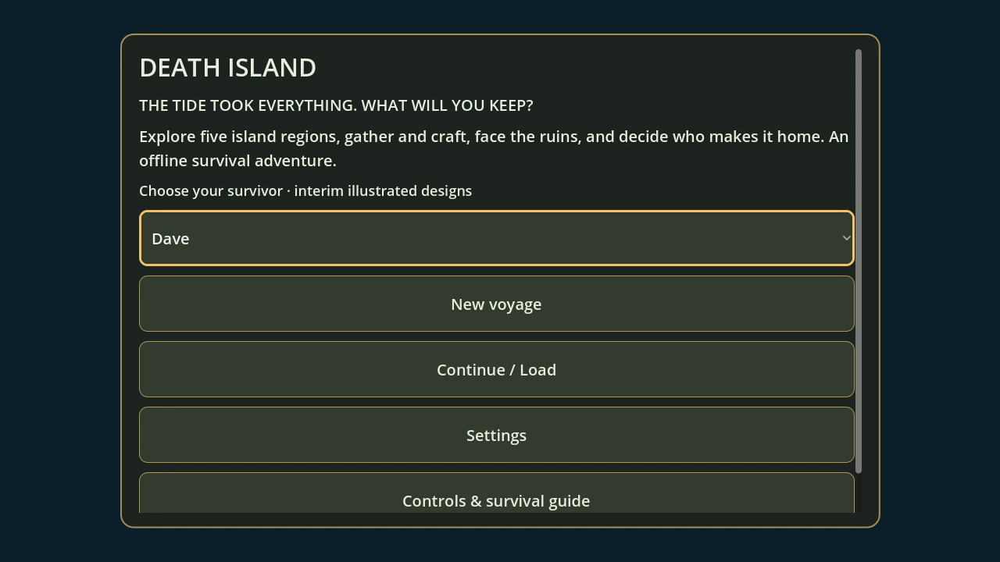
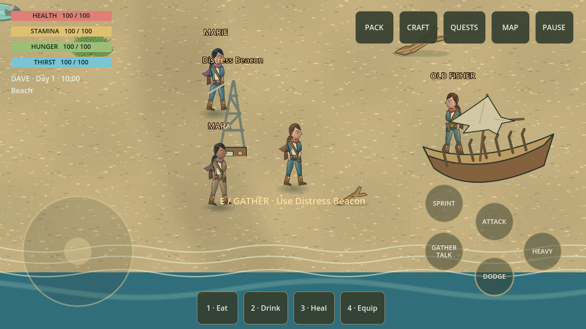
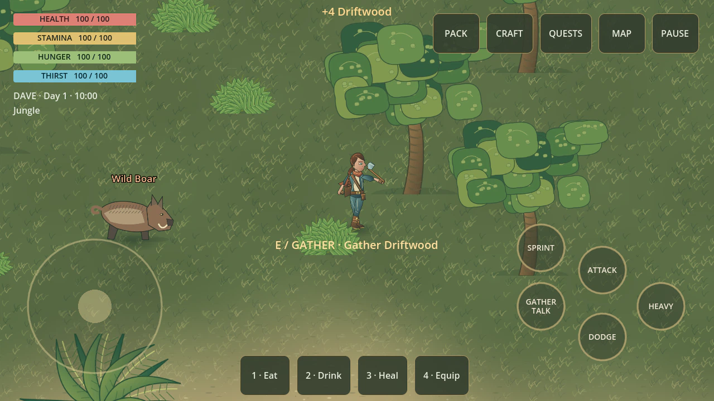
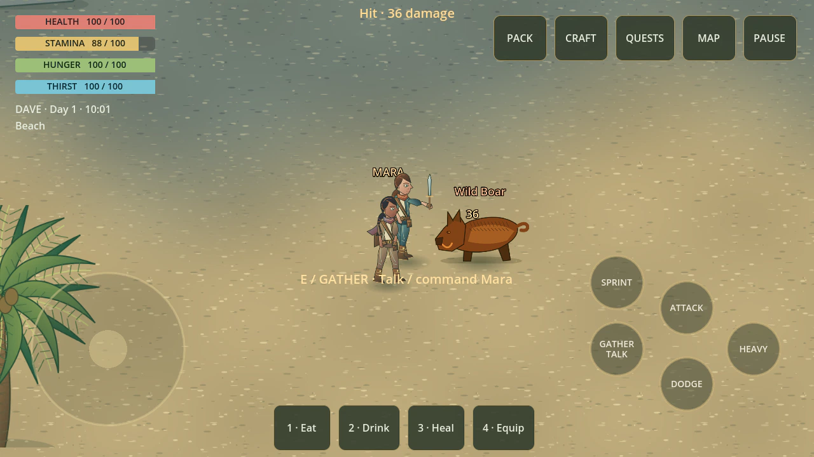
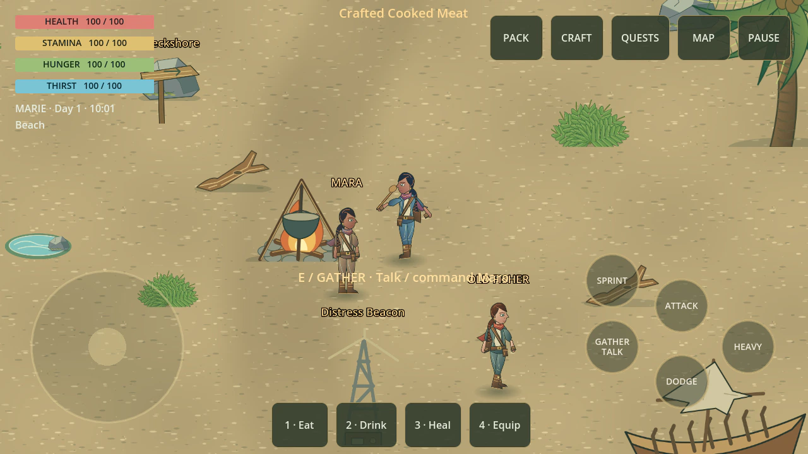
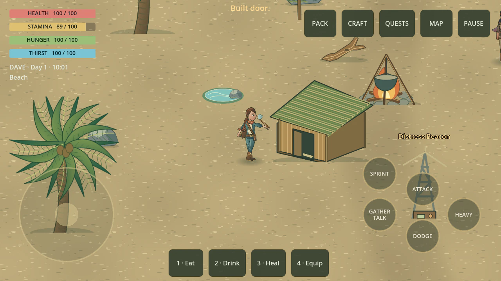

# Death Island

An offline **illustrated 2.5D survival adventure for Android**, built with Godot
4.3, GDScript and the Compatibility renderer. Choose **Dave or Marie**, explore the island,
build a camp and decide who makes it home.

## Manual-test candidate — 0.3.0-dev-rc1

The **Linux ARM64 portable ZIP** uses the existing desktop export preset and is
tested after extraction with its embedded Godot runtime. Download the
`death-island-manual-test-linux-arm64` artifact from the latest successful
[feature-branch CI run](https://github.com/D8v1d777/death-island/actions/workflows/ci.yml?query=branch%3Afeat%2Fdave-marie-character-pipeline).
Extract the artifact, then the enclosed game ZIP, and launch `death-island.arm64`.
This is ARM Linux software, **not a Windows/x86 executable**. It needs X11/XWayland
and OpenGL 3.3. No Godot editor or account is required to run the extracted game.

The `death-island-debug-apk` artifact is the Android ARM64 companion build. APK
archive/signature/content checks are automated; physical-device installation and
16-KiB-page compatibility are not certified. These are manual-test artifacts,
not production releases. Branch pushes cannot automatically publish a beta.

[Testing instructions](docs/manual-test/README-TESTING.txt) ·
[Manual checklist](docs/manual-test/MANUAL-QA-CHECKLIST.txt) ·
[Candidate audit and limitations](docs/audits/MANUAL_TEST_RC1.md)

## In-game gallery — 0.3.0-dev-rc1

Six new live captures from the manual-test candidate, showing Dave and Marie.
The capture runner prepares encounters/inventory and executes real gameplay
actions; these are Linux OpenGL captures with the mobile HUD, not phone photographs.
The project art uses an illustrated, fixed-angle presentation. Dave/Marie currently
reuse original project geometry with different palettes; faithful approved-reference
art is still blocked on recovery of the original images.

| Title & Character Select | Exploring Wreckshore |
|---|---|
|  |  |
| **Gathering with companion** | **Combat with companion assist** |
|  |  |
| **Marie cooking at camp after switching** | **Marie building a shelter** |
|  |  |

[Capture evidence](docs/images/gallery.json) ·
[Gallery generation and verification](docs/audits/GALLERY.md)

## Playable development build

* Five authored regions: Wreckshore, Jungle, Cliffs, Cave and Ruins.
* Gathering, stack/weight-limited inventory, crafting, food and water.
* Light/heavy attacks, stamina sprinting, dodge immunity and four enemy archetypes.
* Campfire cooking, workbench armor, iron forging, equipment condition/repair and
  a four-piece shelter with resting.
* Three branching quests, Mara's trust/recruitment, companion combat/loot assist,
  and three narrative endings.
* Day/night cycle, discovery-based travel, touch/keyboard/gamepad input.
* Dave-default title selection, Marie selection, and Pause-menu switching with separate character packs/vitals preserved by save/load; safe default-ID and texture fallbacks.
* Adjustable text size, failure-safe quit/save behavior and persisted loot when world pickup capacity is full.
* Title, pause, inventory, crafting, journal, map, settings and death screens.
* Ten manual saves, quicksave and autosave; CRC32 validation, backups and v1 migration.

**This is a playable illustrated development build; M4 device/release validation is pending.** See
[the implementation and validation ledger](docs/ROADMAP.md) for remaining art,
performance, accessibility and on-device work.

[Current stabilization evidence](docs/audits/STABILIZATION.md) ·
[Release blockers and phone checklist](docs/audits/RELEASE_READINESS.md) ·
[Development release notes](RELEASE_NOTES.md) · [Privacy](docs/PRIVACY.md)

## Run from source

```bash
godot --headless --path src --editor --import --quit
godot --path src
```

The project lives in `src/`, not the repository root. Start a **New voyage**, gather
driftwood and stone by hand, craft/equip a Stone Axe, and talk to Mara near spawn.

### Controls

| Action | Keyboard / mouse | Touch |
|---|---|---|
| Move | WASD; Shift sprint | Left joystick; hold Sprint |
| Camera | Mouse wheel zoom; fixed angled view | Drag right side vertically to zoom |
| Interact | E | Gather / Talk |
| Attack / Heavy | Left / right mouse | Attack / Heavy |
| Dodge | Space | Dodge |
| Inventory / Craft / Journal | Tab / C / J | Top buttons |
| Pause | Escape | Pause |
| Eat / Drink / Heal / Equip | 1 / 2 / 3 / 4 | Bottom quick buttons |

Gamepad: left stick moves, right stick vertically zooms, A interacts, X/Y attack, B dodges, Start
pauses, Back opens the inventory. The in-game guide explains progression.

## Verify

```bash
uv tool install --with setuptools==80.9.0 gdtoolkit==4.3.3
python3 tools/check.py
```

Alternatively install `tools/requirements.txt` in a Python virtual environment.
The wrapper rejects Godot error output even if the engine returns exit code zero.
Unit and integration runners exercise production APIs and use isolated test saves.

Build and independently test the final Linux ARM64 ZIP from a clean committed tree:

```bash
python3 tools/build_manual_test.py
```

Output: `build/manual-test-rc1/death-island-0.3.0-dev-rc1-linux-arm64.zip`, with a
SHA-256 sidecar, testing instructions, release notes and a manual checklist.

Rendered UI smoke test on Linux:

```bash
DEATH_ISLAND_CAPTURE_DIR="$PWD/build/screenshots" LIBGL_ALWAYS_SOFTWARE=1 \
  xvfb-run -a godot --path src --audio-driver Dummy res://tests/integration/RenderSmoke.tscn
```

### Reproduce the gameplay gallery

```bash
DEATH_ISLAND_GALLERY_DIR="$PWD/docs/images" python3 tools/check.py --gallery
python3 tools/validate_gallery.py docs/images --readme README.md
```

## Phone storage budget

The 2.5D art uses compact SVG source and the gallery uses WebP captures. No large
art pack is required. `tools/illustrate.py` describes the original art library;
the dedicated Dave/Marie strips are separately maintained interim derivatives.

About **2.99 GiB** of verified disposable development files was reclaimed on the
Termux/Ubuntu host. Development requires a **15 GiB free-space minimum**, with a
mandatory **pause and inspection at 18 GiB or below**.

```bash
python3 tools/storage.py          # report explicit cleanup candidates
python3 tools/storage.py --apply  # remove only those reproducible artifacts
```

The cleanup tool preserves source, game saves, signing keys, the Android/ARM64
templates and cached dependency downloads. It can reclaim Android build
intermediates again after an APK has been verified.

## Build Android

Prerequisites: matching Godot 4.3 export templates, **JDK 21**, SDK platforms 34/35,
and build-tools 34.0.0. First Gradle build downloads dependencies.

```bash
sdkmanager 'platforms;android-34' 'platforms;android-35' 'build-tools;34.0.0'
export ANDROID_HOME="$HOME/Android"
export JAVA_HOME=/path/to/jdk-21
python3 tools/build_android.py
```

On Linux ARM64, install native `adb`, `zipalign` and `aapt2` first (Ubuntu:
`apt install adb zipalign aapt`). The script creates an SDK overlay under `build/`
without replacing the SDK's x86 tools. It configures Godot's SDK/JDK editor paths.

The generated Gradle template is pinned to Gradle 8.5 (checksum verified) and
Android Gradle Plugin 8.2.2 for JDK 21 compatibility. Generated Android files live
under ignored `src/android/`; all required customizations are in the build script.

Output: **`build/death-island-debug.apk`**, package `org.deathisland.game`, ARM64,
min SDK 24, target SDK 35. The script verifies the APK archive, architecture and
debug signature. Release signing/AAB publication require separate release work.

To install on a connected device:

```bash
adb install -r build/death-island-debug.apk
```

## Development skill

The Skills marketplace's `wshobson/agents` **godot-gdscript-patterns** is installed
project-locally under `.agents/skills/`. Provenance is recorded in `skills-lock.json`;
`opencode.json` registers the path. Restart OpenCode from this repository to discover
it. The game itself needs no third-party Godot addon.

## Documentation

* [Architecture](docs/ARCHITECTURE.md)
* [Roadmap and outstanding gates](docs/ROADMAP.md)
* [Quality gates](docs/QUALITY_GATES.md)
* [Product requirements](docs/PRD.md)
* [Asset provenance](docs/research/asset-provenance.md)
* [Contributing](CONTRIBUTING.md) · [License](LICENSE)
