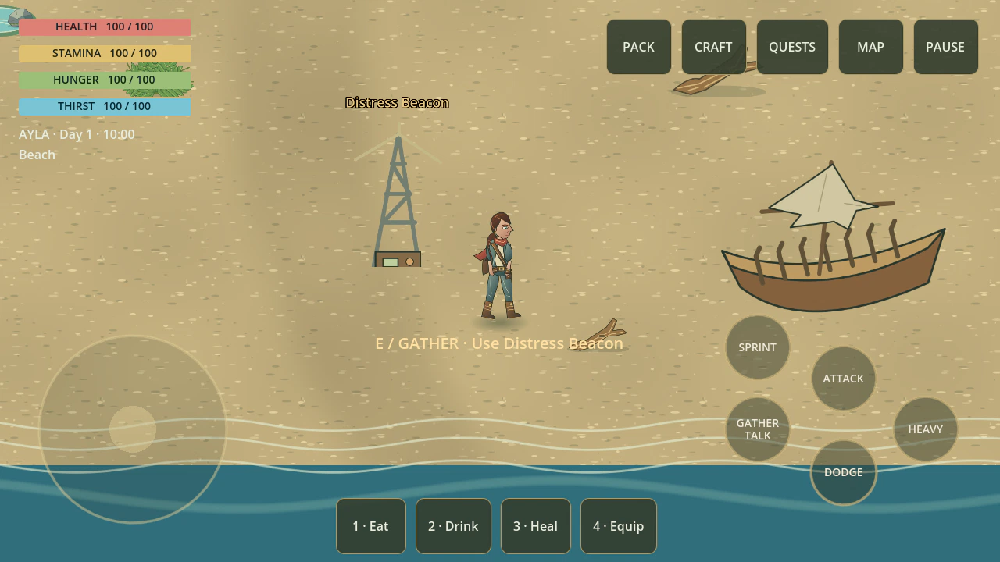
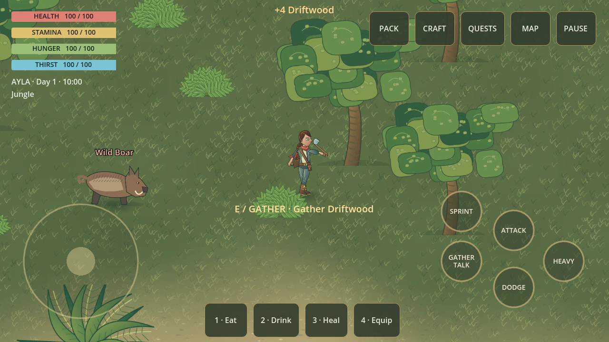
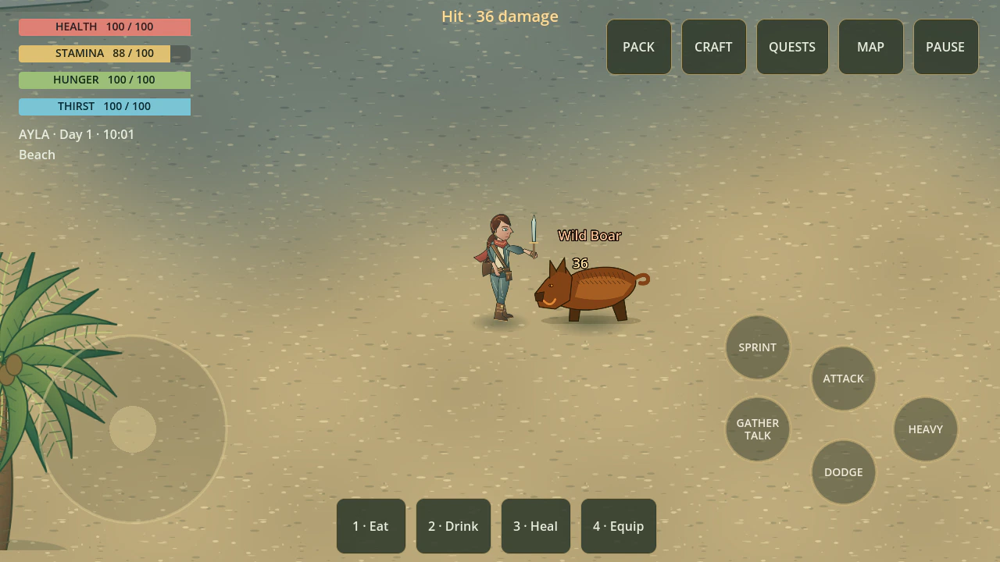
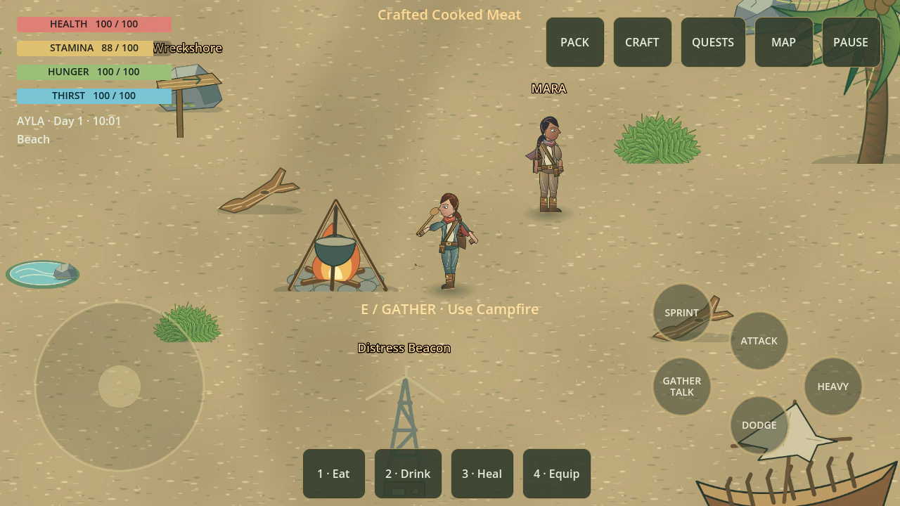
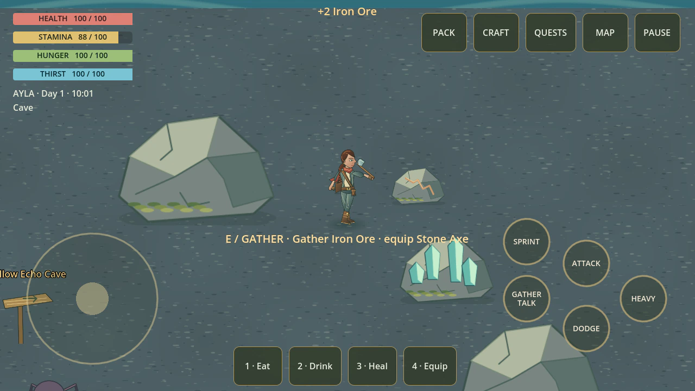

# Death Island

An offline **illustrated 2.5D survival adventure for Android**, built with Godot
4.3, GDScript and the Compatibility renderer. Play as **Ayla**, explore the island,
build a camp and decide who makes it home.

## In-game gallery — 0.3.0-dev

Six actual captures from the running game, showing the controlled character.
The capture runner prepares encounters/inventory and executes real gameplay
actions; these are Linux OpenGL captures with the mobile HUD, not phone photographs.
The art is original and uses an illustrated, fixed-angle presentation.

| Exploring Wreckshore | Gathering wood in the jungle |
|---|---|
|  |  |
| **Fighting a wild boar** | **Cooking at camp** |
|  |  |
| **Mining iron in Hollow Echo** | **Building a shelter** |
|  |  |

[Capture evidence](docs/images/gallery.json) ·
[Reproduce the six captures](src/tests/integration/GameplayGallery.gd)

## Playable development build

* Five authored regions: Wreckshore, Jungle, Cliffs, Cave and Ruins.
* Gathering, stack/weight-limited inventory, crafting, food and water.
* Light/heavy attacks, stamina sprinting, dodge immunity and four enemy archetypes.
* Campfire cooking, workbench armor, iron forging, equipment condition/repair and
  a four-piece shelter with resting.
* Three branching quests, Mara's trust/recruitment, companion combat/loot assist,
  and three narrative endings.
* Day/night cycle, discovery-based travel, touch/keyboard/gamepad input.
* Title, pause, inventory, crafting, journal, map, settings and death screens.
* Ten manual saves, quicksave and autosave; CRC32 validation, backups and v1 migration.

**This is a playable illustrated development build; M4 device/release validation is pending.** See
[the implementation and validation ledger](docs/ROADMAP.md) for remaining art,
performance, accessibility and on-device work.

## Run from source

```bash
godot --headless --path src --editor --import --quit
godot --path src
```

The project lives in `src/`, not the repository root. Start a **New voyage**, gather
driftwood and stone by hand, craft/equip a Stone Axe, and talk to Mara near spawn.

### Controls

| Action | Keyboard / mouse | Touch |
|---|---|---|
| Move | WASD; Shift sprint | Left joystick; hold Sprint |
| Camera | Mouse wheel zoom; fixed angled view | Drag right side vertically to zoom |
| Interact | E | Gather / Talk |
| Attack / Heavy | Left / right mouse | Attack / Heavy |
| Dodge | Space | Dodge |
| Inventory / Craft / Journal | Tab / C / J | Top buttons |
| Pause | Escape | Pause |
| Eat / Drink / Heal / Equip | 1 / 2 / 3 / 4 | Bottom quick buttons |

Gamepad: left stick moves, right stick vertically zooms, A interacts, X/Y attack, B dodges, Start
pauses, Back opens the inventory. The in-game guide explains progression.

## Verify

```bash
uv tool install --with setuptools==80.9.0 gdtoolkit==4.3.3
python3 tools/check.py
```

Alternatively install `tools/requirements.txt` in a Python virtual environment.
The wrapper rejects Godot error output even if the engine returns exit code zero.
Unit and integration runners exercise production APIs and use isolated test saves.

Rendered UI smoke test on Linux:

```bash
DEATH_ISLAND_CAPTURE_DIR="$PWD/build/screenshots" LIBGL_ALWAYS_SOFTWARE=1 \
  xvfb-run -a godot --path src --audio-driver Dummy res://tests/integration/RenderSmoke.tscn
```

### Reproduce the gameplay gallery

```bash
DEATH_ISLAND_GALLERY_DIR="$PWD/docs/images" LIBGL_ALWAYS_SOFTWARE=1 \
  xvfb-run -a godot --path src --audio-driver Dummy --fixed-fps 30 \
  res://tests/integration/GameplayGallery.tscn
```

## Phone storage budget

The 2.5D art uses about **321 KiB of SVG source**, and the six WebP screenshots
use less than **700 KiB**. Generated textures remain small; no large art pack is
required. The original art can be regenerated with `python3 tools/illustrate.py`.

About **2.99 GiB** of verified disposable development files was reclaimed on the
Termux/Ubuntu host. Android builds enforce an **8 GiB free-space reserve**.

```bash
python3 tools/storage.py          # report explicit cleanup candidates
python3 tools/storage.py --apply  # remove only those reproducible artifacts
```

The cleanup tool preserves source, game saves, signing keys, the Android/ARM64
templates and cached dependency downloads. It can reclaim Android build
intermediates again after an APK has been verified.

## Build Android

Prerequisites: matching Godot 4.3 export templates, **JDK 21**, SDK platforms 34/35,
and build-tools 34.0.0. First Gradle build downloads dependencies.

```bash
sdkmanager 'platforms;android-34' 'platforms;android-35' 'build-tools;34.0.0'
export ANDROID_HOME="$HOME/Android"
export JAVA_HOME=/path/to/jdk-21
python3 tools/build_android.py
```

On Linux ARM64, install native `adb`, `zipalign` and `aapt2` first (Ubuntu:
`apt install adb zipalign aapt`). The script creates an SDK overlay under `build/`
without replacing the SDK's x86 tools. It configures Godot's SDK/JDK editor paths.

The generated Gradle template is pinned to Gradle 8.5 (checksum verified) and
Android Gradle Plugin 8.2.2 for JDK 21 compatibility. Generated Android files live
under ignored `src/android/`; all required customizations are in the build script.

Output: **`build/death-island-debug.apk`**, package `org.deathisland.game`, ARM64,
min SDK 24, target SDK 35. The script verifies the APK archive, architecture and
debug signature. Release signing/AAB publication require separate release work.

To install on a connected device:

```bash
adb install -r build/death-island-debug.apk
```

## Development skill

The Skills marketplace's `wshobson/agents` **godot-gdscript-patterns** is installed
project-locally under `.agents/skills/`. Provenance is recorded in `skills-lock.json`;
`opencode.json` registers the path. Restart OpenCode from this repository to discover
it. The game itself needs no third-party Godot addon.

## Documentation

* [Architecture](docs/ARCHITECTURE.md)
* [Roadmap and outstanding gates](docs/ROADMAP.md)
* [Quality gates](docs/QUALITY_GATES.md)
* [Product requirements](docs/PRD.md)
* [Asset provenance](docs/research/asset-provenance.md)
* [Contributing](CONTRIBUTING.md) · [License](LICENSE)
